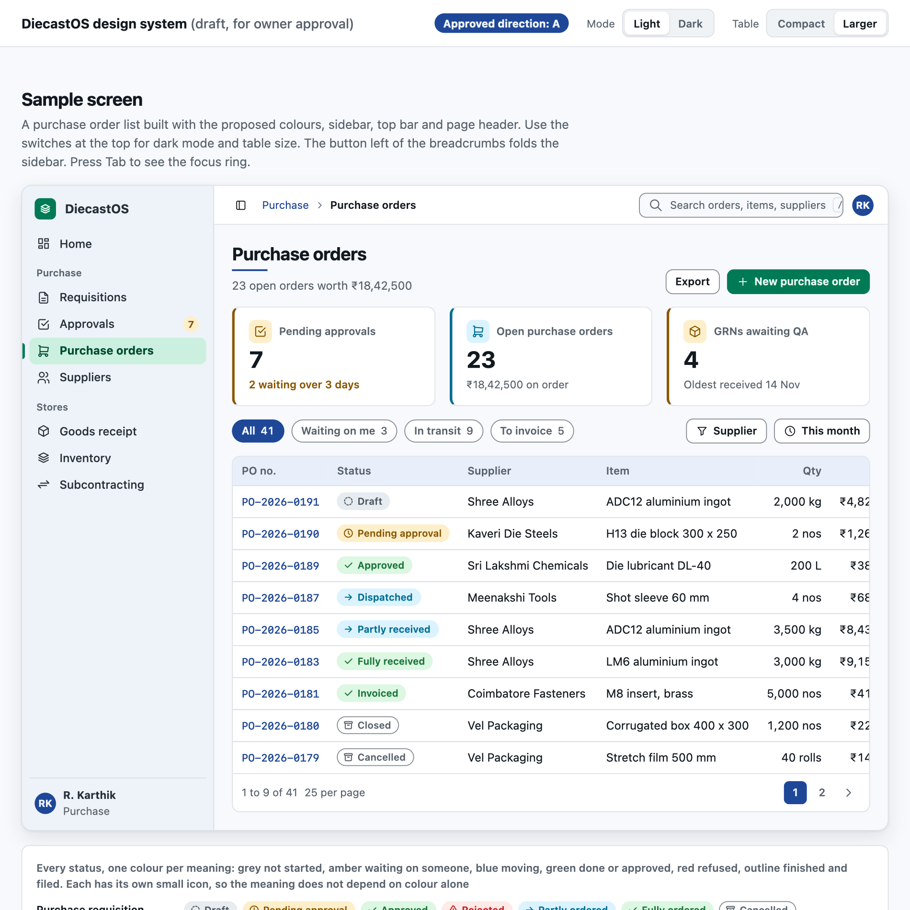
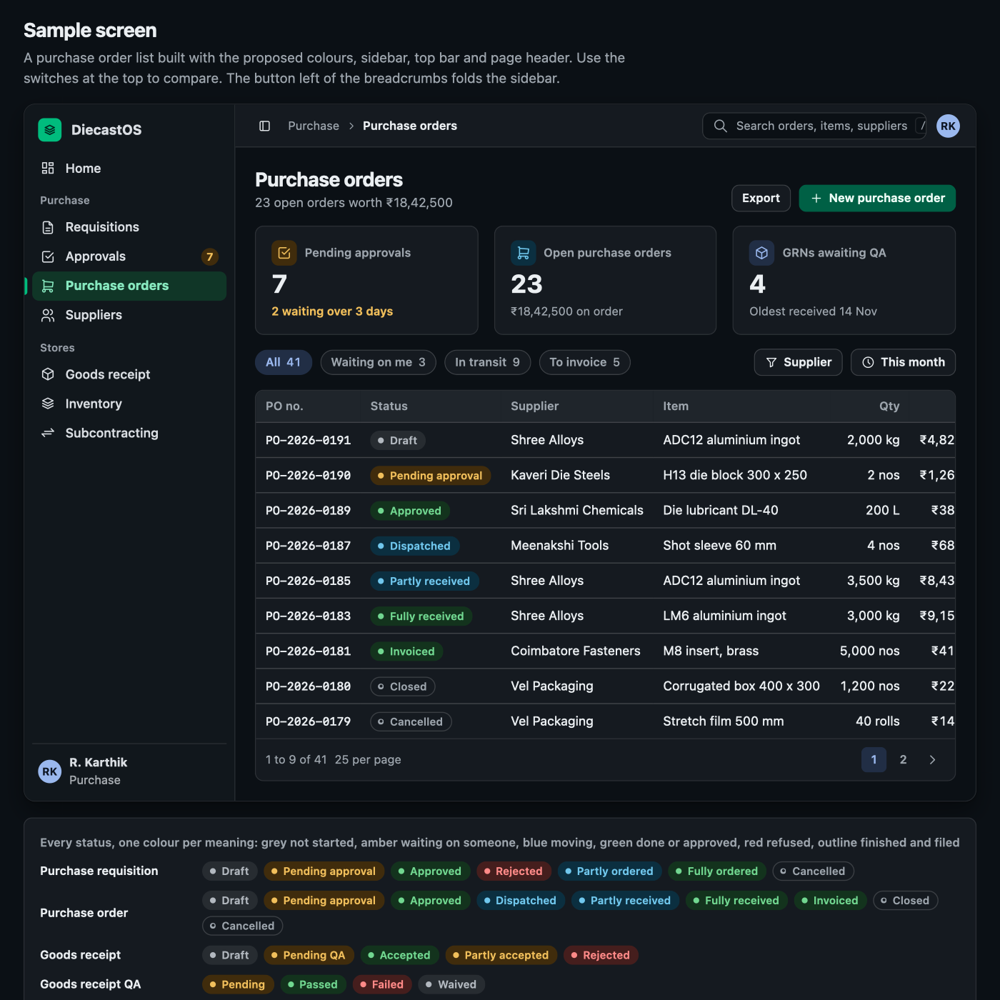

# Design system — for your approval
## 1. What you asked for
The app feels "too boring and too black and white". Keep shadcn. Add "a few more colours" in light and dark
mode and "little animations", with strict control over where they are used "so that it does not look childish".
## 2. What the user will be able to do
- See the same colour for the same meaning: grey not started, amber waiting on someone, blue moving, green approved or done, red refused or late. Badge text is a little bigger (11 px, today 10 px) and each badge has a small icon.
- Find their place faster: icons in the sidebar, a tinted active menu item, breadcrumbs on top, a blue outline on whatever the keyboard is on.
- Read the purchase order pages in light and dark mode (today the status badges stay bright in dark mode), with one page title, filters, empty screen, error screen and page numbers. Other modules follow.
- See small movement in eight places only. Nothing bounces, loops or slides between pages.
> Example: PO-2026-0190 for ₹1,26,500.00 waits for approval. It shows an amber "Pending approval" badge with a clock icon on the order list and the order page.
> You approve it: the row is tinted light blue once for 0.6 seconds, the badge turns green, and a message says "Purchase order approved".
## 3. Screens
**Open `docs/specs/design-system/preview.html` in your browser.** Use the two switches at the top (light or dark, table size) and press the buttons in the Motion section.

The purchase order list in the direction you chose, light and dark: the user filters, opens an order, starts a new one.
## 4. Decisions for you
### Card 1 — Which second colour goes next to the emerald?
- **A (recommended):** Industrial calm. Steel blue, cool grey page and sidebar.
- **B:** Warm foundry. Copper, warm grey page and sidebar.
- **For the factory user:** In B the copper sits close to the amber "waiting" colour, so a selected filter can be read as a warning. A keeps every colour clearly apart. **Cost:** same for both.
- **Your answer:** A (owner, 2026-11-18: "all recommended")
### Card 2 — How big should table rows be?
- **A:** Keep today's compact size only (12 px text, 30 px rows; about 24 rows on a 1080p screen).
- **B (recommended):** Slightly larger by default (13 px text, 36 px rows; about 20 rows), with a "Compact" switch each user can turn on.
- **For the factory user:** B is easier to read over a long shift; A shows about 4 more rows. **Cost:** B adds about half a day.
- **Your answer:** B (owner, 2026-11-18: "all recommended")
### Card 3 — How strong should the sidebar be? (Icons are added in both.)
- **A (recommended):** Soft. Light tinted sidebar, emerald tint on the active item.
- **B:** Strong. Dark sidebar in light mode too, so the app is recognised from across the room.
- **For the factory user:** A is calmer for long sessions; B has more character but is a heavy dark block beside the tables all day. **Cost:** same for both.
- **Your answer:** A (owner, 2026-11-18: "all recommended")
### Card 4 — Do you approve the list of places that may move?
- **A (recommended):** Yes, these eight and no others: (1) dialog, side sheet and dropdown opening and closing, (2) message pop-up, (3) sidebar folding, (4) table row hover, (5) button press, (6) loading placeholder, (7) one 0.6 s tint on a row whose status just changed, (8) number count-up on home page cards.
- **Never, in both options:** page-to-page transitions, bounce or spring, looping, movement on scroll, decoration that moves.
- **B:** Colours only for now, no movement at all.
- **For the factory user:** With A the screen answers each action; users who switch on "reduce motion" on their computer see none. **Cost:** A adds about one day. A ninth place later needs your yes.
- **Your answer:** A (owner, 2026-11-18: "all recommended")
### Card 5 — Bigger touch targets for shop-floor tablets: now or later?
- **A (recommended):** Later, after the first tablet trial. No shop-floor screen exists yet.
- **B:** Now. Every button, row and field also gets a 44 px touch size.
- **For the factory user:** Desktop users see no difference. Tablets work with A, but targets are small. **Cost:** B adds about three days and doubles the screens to check.
- **Your answer:** A (owner, 2026-11-18: "all recommended")
### Card 6 — Number cards on the home page: now or later?
- **A (recommended):** Later, as the next small feature (pending approvals, open orders, GRNs awaiting QA). This work builds the card itself, so that feature is quick.
- **B:** Now, inside this work.
- **For the factory user:** With A the home page stays as it is for now. **Cost:** B adds about two days and needs three new counts from the server.
- **Your answer:** A (owner, 2026-11-18: "all recommended")
## 5. Decided for you — please confirm
Answer like "1 yes, 2 no". A "no" becomes a card.
1. Draft turns grey (today amber); amber now only means "waiting on someone".
2. Cancelled and Closed become a grey outline (today a cancelled order is red, a closed job work order green).
3. A partly accepted GRN turns amber (today violet); a waived QA check turns grey (today blue).
4. Status names read as plain words: "Partly ordered", "Partly received", "Pending QA", "Sent back" (today "partial ordered").
5. Money shows paise in tables, documents and forms (₹4,82,000.00) and whole rupees on summary cards.

Everything else: 40 technical choices logged. No reading needed.
## 6. Not included
- The new look on the other modules' pages. This work does the menu, the top bar and the purchase order pages (list, order, form); the rest follows as the next job.
- The home page dashboard content, what the top-bar search finds, phone layout, print and PDF layouts.
- A logo, other languages, and charts on real data (only the five chart colours are fixed here).
