# Factory flows — for your approval

## 1. What you asked for
Each person opens the app and sees their own pending work, one click from doing it.
Requisitions, orders and receipts get real pages that offer the next step; store keepers receive goods themselves.

## 2. What the user will be able to do
- Home counts the work waiting for you (late / today / later); one click opens exactly those rows.
- Each requisition, order and receipt has its own page (lines, totals, approvals, links, history) and offers the next step.
- Store keepers start a receipt from Goods receipts, never see prices; approvers decide from a preview; lists show 50 rows.
> Example: S asks for ADC12 1000 kg + die lube 20 L (₹2,51,000); B approves. Create PO drafts PO-2026-11-1:
> 1000 kg × ₹245 + 18 % GST = ₹2,89,100. 600 kg arrive (challan CH-11); Home still expects 400 kg.

## 3. Screens

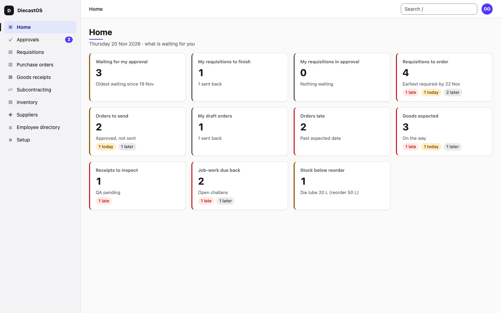
Home: tiles of waiting work; click a tile, or just its "late" part.

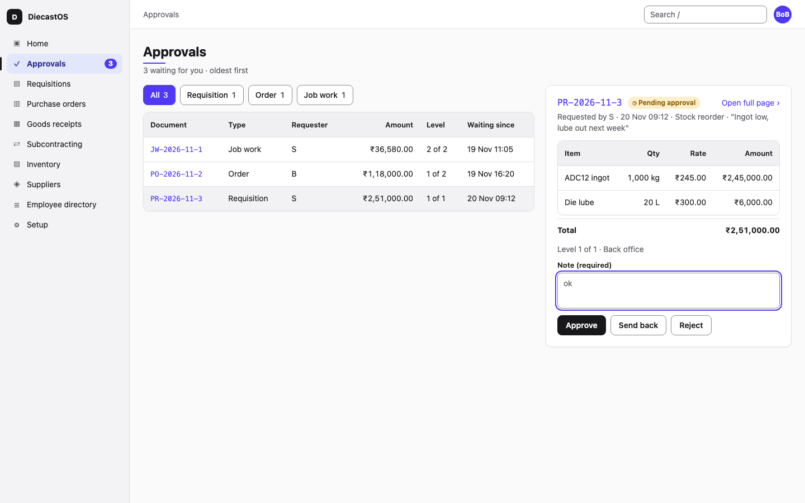
Approvals: read the whole document beside the list, type a note, decide.

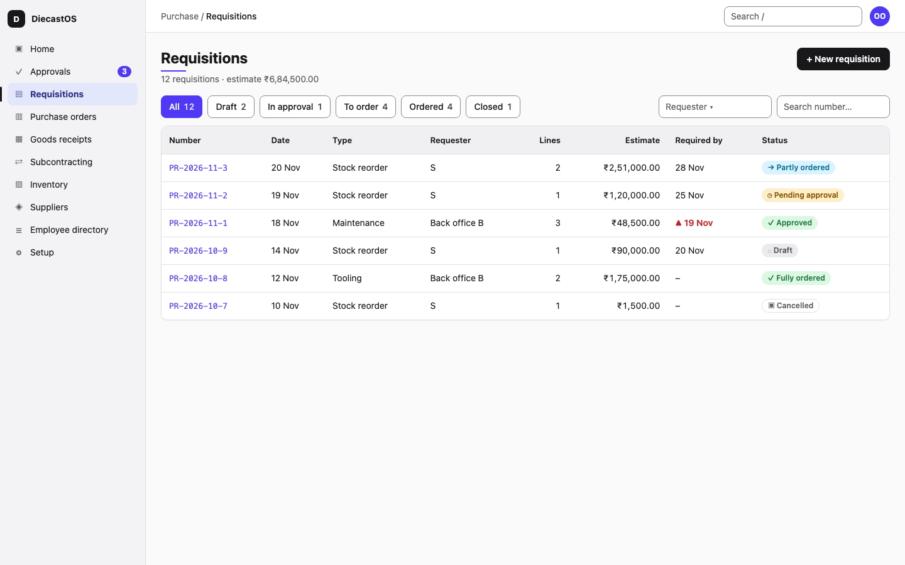
Requisitions: find one, filter by the counts on top, start a new one.

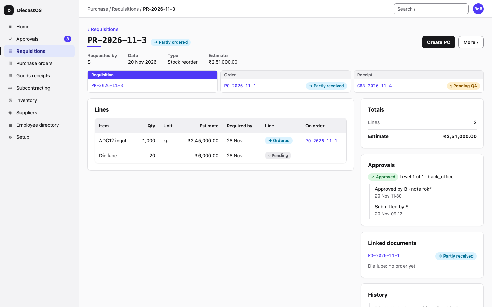
Requisition page: lines, its orders, history; "Create PO" when approved.

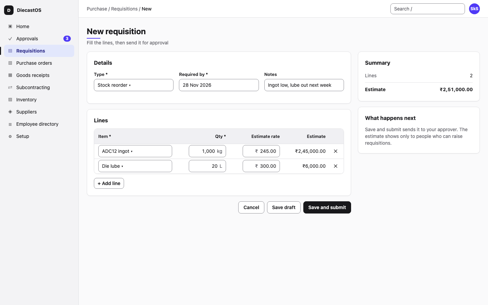
Requisition form: full page; "Save and submit" in one click.

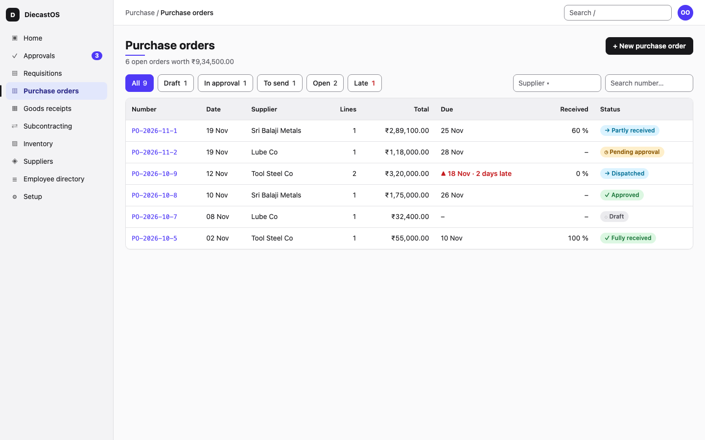
Orders: late and unsent orders counted on top.

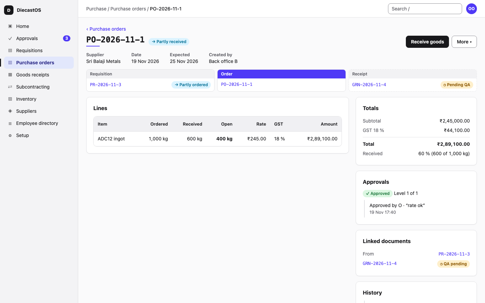
Order page: received and open quantity per line; Send or Receive goods.

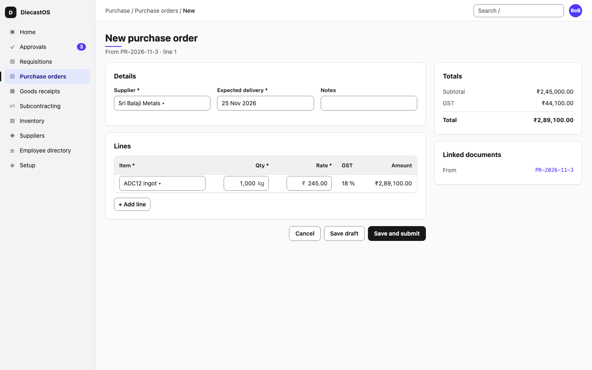
Order form: full page, totals beside the lines.

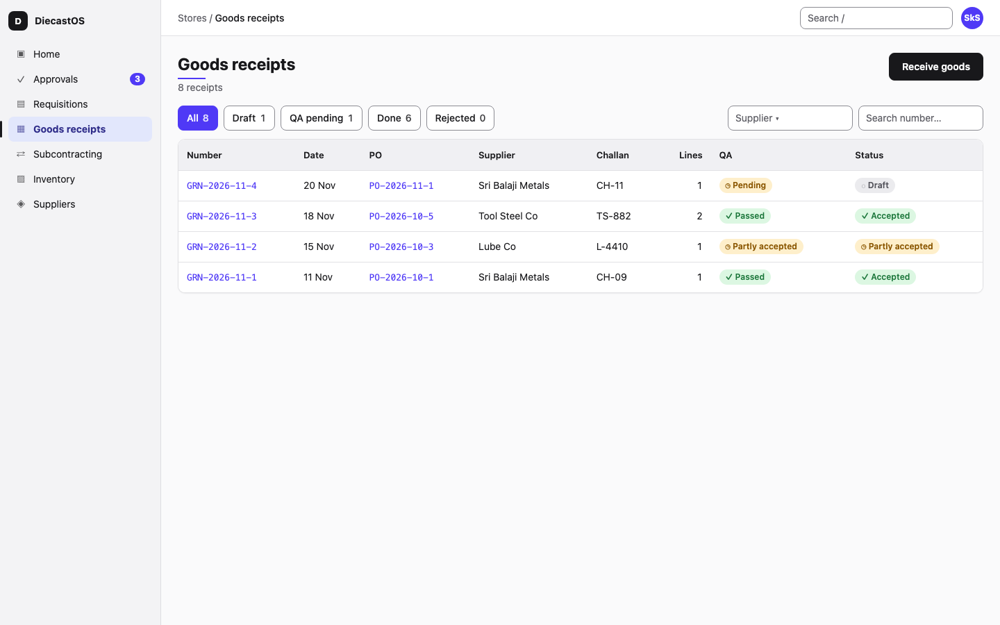
Goods receipts: QA state per receipt; big "Receive goods" button.

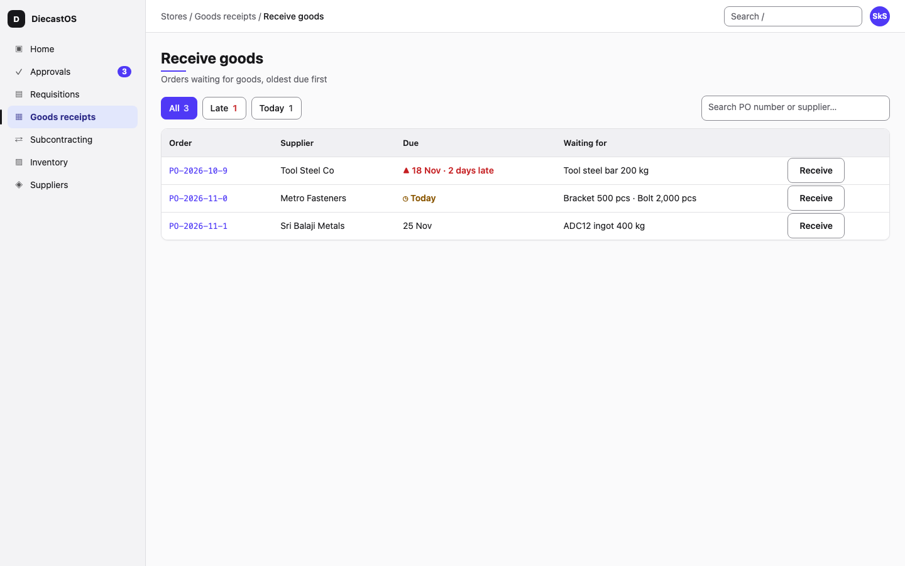
Receive goods: pick the order the truck brought, oldest due first.

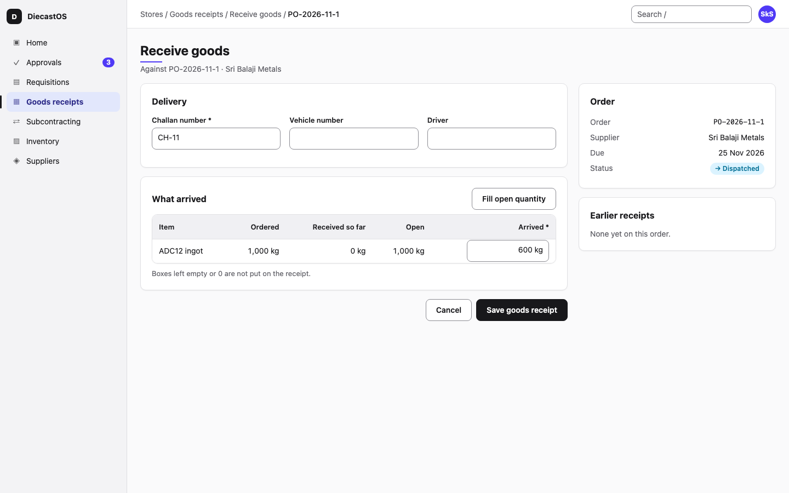
Receive form: type what arrived per line, or "Fill open quantity".

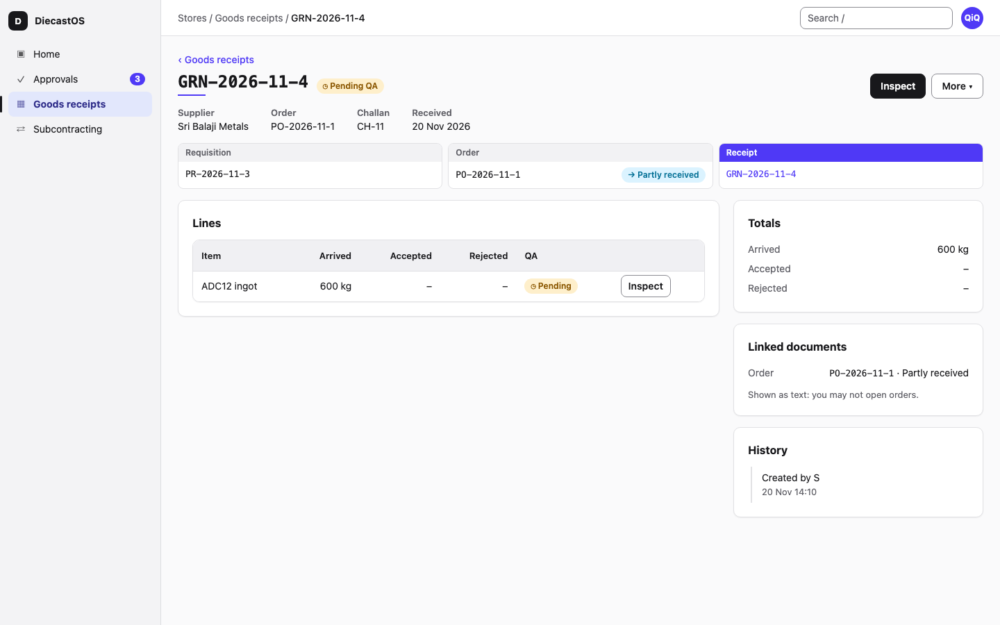
Receipt page: accepted and rejected quantity; Inspect each pending line.

## 4. Decisions for you
### Card 1 — A requisition has lines for two suppliers. What does "Create PO" make?
- **A (recommended):** One draft order per supplier (ADC12 → Sri Balaji, die lube → Lube Co); drafts only, nothing sent by itself.
- **B:** One order for the first supplier; the other lines wait for another click.
- **For the factory user:** A: the purchase officer checks and sends each draft (ERPNext and Odoo do the same). B: more clicks, lines get forgotten. **Cost:** none either way.
- **Your answer:** A — pre-approved in chat, 2026-11-20: "automate that sessions take ur own decision and record them".
### Card 2 — Receive form: does the arrived box start empty or filled with the open quantity?
- **A (recommended):** Empty, with a "Fill open quantity" button for when everything came.
- **B:** Filled with the open quantity (SAP and ERPNext do this).
- **For the factory user:** A: the store keeper types what was counted; one tap if all came. B: faster, but a blind save records goods that never came. **Cost:** none either way.
- **Your answer:** A — pre-approved in chat, 2026-11-20: "make sure u reasearch other erp's and take decision and build".
### Card 3 — What does the plant head see first on Home?
- **A (recommended):** "Waiting for my approval" — work stuck behind you blocks others (SAP shows approvals first).
- **B:** "Orders late".
- **For the factory user:** A: approvals clear faster each morning. B: late suppliers chased first. **Cost:** none either way.
- **Your answer:** A — pre-approved in chat, 2026-11-20: "automate that sessions take ur own decision and record them".

## 5. Decided for you — please confirm
All pre-approved in chat on 2026-11-20 ("take ur own decision and record them"); say "no" to a line and it becomes a card.
- Home shows one tile per queue you can act on, and nothing for queues you cannot (Odoo, SAP, ERPNext).
- Dated tiles split into late (red), today (orange) and later (grey), by Indian date (Odoo).
- Pages show only the buttons you may use, one main button for the next step (ERPNext).
- "Save and submit" sits beside "Save draft"; if submit is refused, the draft stays saved (ERPNext).
- An approver without buying rights reads the document, prices included, only while it waits at their step or after they acted on it; the requester likewise only while it waits (SAP, ERPNext).
- Store keepers see orders to receive with items, quantities and dates, never prices (SAP; stricter).
- Approvers can decide from the preview, which shows every line, price and total first, with a note (SAP; stricter).
- Menu order: Home, Approvals, Requisitions, Orders, Goods receipts, Job work, Inventory, Suppliers, then admin (ERPNext).
- The new menu order is applied once and skips any menu entry an admin already renamed or moved (standard).
- Create PO takes each line's supplier from its last order and asks for supplier or rate when missing (ERPNext).
- Nobody sees amounts on another person's approval list; approval-only readers never see supplier message text (stricter).
- Lists show 50 rows a page, with 25 or 100 to choose (Odoo 80, ERPNext 20).
- Goods waiting for inspection count as arrived when receiving (400 kg left, not 1000), but the order stays late until they pass (SAP; our order rule).
- A receipt with several lines waiting for inspection has an Inspect button on each line (ERPNext).
- Receiving screens use bigger buttons and boxes for tablets at the gate; rows stay normal height (our choice).
- Home tiles get a late / today / later chip row, a new look for the shared tile used across the app (our choice).
- The receive form asks challan, vehicle, driver and quantity; heat number stays on the receipt edit (SAP).

Everything else: 70 edge cases decided by ERP benchmark, 64 technical choices logged. No reading needed.

## 6. Not included
- Notifications, global search by document number, deputy approvers, over-receipt limit changes, "close the balance" at receipt; heat checks, BOM, sale order, production, per-user Home.
